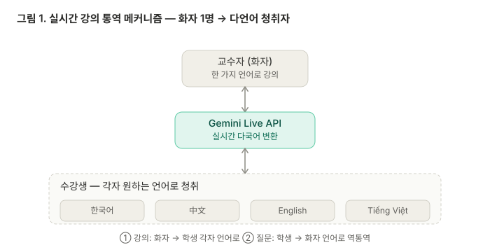
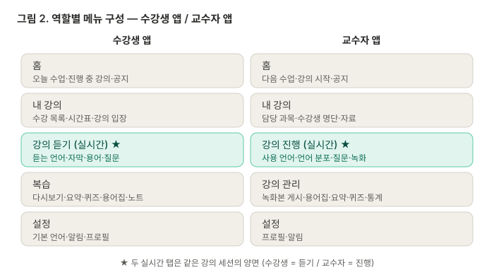
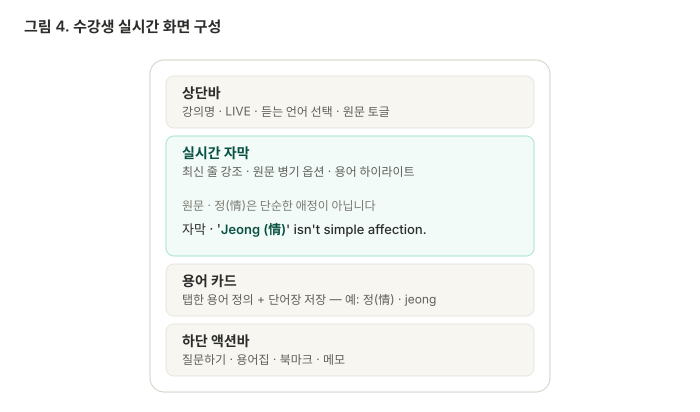
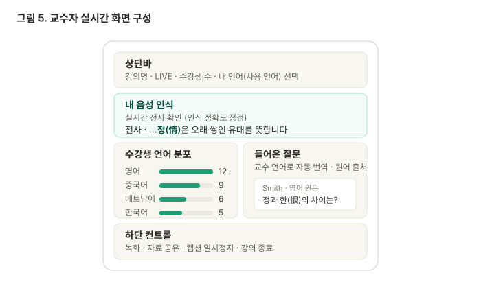
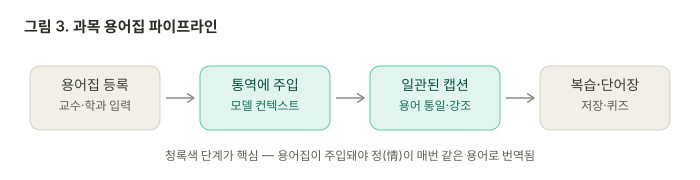

# 실시간 강의 통역 앱 — 기술 명세서

대학 강의를 **실시간 자막으로 다국어 통역**하는 독립형 애플리케이션. 한 명의 화자(교수)가 말하면 여러 언어의 청취자(학생)가 각자 원하는 언어의 자막으로 듣고, 질문은 역방향으로 흐른다. 수업이 끝나면 AI 요약과 퀴즈가 자동 생성된다.

> 본 문서는 Claude Code 구현을 위한 명세서다. 코드 예시는 의도적으로 최소화하고, 아키텍처·데이터 모델·흐름·통합 지점을 우선 기술한다.

---

## 0. 구현 현황 — 초기 구상 → 실제 (2026-06)

> **§1~11은 초기 구상안**이다. 실제 구현이 아래처럼 달라졌으며, **실제 동작·결정은 §0 + §12 기준**이다(충돌 시 §0/§12 우선). 미래 비전(요약·퀴즈·녹화 등)은 §1~11에 그대로 남겨 둔다.

### 0.1 아키텍처 — 초기안 → 실제
| 항목 | 초기안(§3·§4) | 실제 구현 |
|---|---|---|
| 백엔드 | Node/Python 자체 서버 | **Supabase** (서버 직접 운영 안 함) |
| 실시간 전송 | WebRTC/WebSocket(LiveKit 등) | **Supabase Realtime** — Broadcast(자막)·Presence(언어 분포) |
| ASR(원문 전사) | 백엔드에서 | **교수 브라우저**에서 Gemini Live(`gemini-3.5-live-translate-preview`) |
| 번역 | 백엔드 텍스트 모델 | **교수 브라우저**에서 **활성 언어마다 Gemini Live 세션 1개**(동시 N개) — 각 세션이 그 언어 자막을 스트리밍. (초기엔 `gemini-2.5-flash` 텍스트 팬아웃이었으나 **폐기**) |
| API 키 | 서버에만 | **클라이언트** — 교수만 Gemini 키 필요, 학생은 불필요 |
| 방·인증 | 자체 계정·세션 | **방 코드 + 비밀번호** (Supabase RPC, RLS로 보호) |
| DB | 풀 관계형(§7) | **`rooms` 테이블 1개뿐** — 자막은 Broadcast라 저장 안 함 |
| 프론트/호스팅 | React | **Vite + React, Vercel 배포** |
| 전송층 격리 | — | `web/src/lib/room.ts` 한 파일로 격리 → 추후 학교 서버로 교체 가능 |

### 0.2 기능 상태
| 기능 | 상태 |
|---|---|
| 실시간 자막(교수 방송 → 학생 수신, 다국어) | ✅ 구현 |
| 강의 개설 / 코드+비밀번호 입장 | ✅ 구현(Supabase RPC) |
| 수강생 언어 분포(교수 화면) | ✅ 구현(Presence 자동 집계) |
| 학생: 출력 언어 선택 · 원문+번역/번역만 · 글자 크기 · 자막 보내기 | ✅ 구현 |
| 번역 **음성** 재생 | ✅ **개인 모드만**(1인 통역, 🔈/🔊 토글) · 강의(방송) 모드는 ✖ 텍스트 자막만 |
| **과목 용어집** | ✖ **제외** — 실시간 통역엔 불필요로 결론(2026-06) |
| 양방향(학생→교수) 질문 | ◻️ 향후 |
| 수업 후 요약·퀴즈 | ◻️ 향후 |
| 녹화·다시보기 | ◻️ 향후 |
| 교수 하단탭 IA(§6.2) | ◻️ 단순화됨 — 역할전환 홈 + 단일 실시간 화면 |
| 개인 모드(1인 통역 + 번역 음성) | ✅ 구현 — 「조별 모드」는 폐기하고 이것으로 대체 |

> 상세 구현·결정 근거는 **§12** 참조.

---

## 1. 개요

### 1.1 목적과 시나리오
대학 강의실에는 국적이 섞여 있다. 본 앱은 두 방향을 모두 지원한다.

- **시나리오 A**: 외국인 교수가 모국어로 강의 → 한국 학생이 한국어 자막으로 수강
- **시나리오 B**: 한국인 교수가 한국어로 강의 → 다국적 학생이 각자 모국어 자막으로 수강 (대표 과목 예: **「한국 문화의 이해」**)

두 시나리오는 방향만 다를 뿐 **"화자 1명 → 다언어 청취자 N명"**이라는 동일한 구조다.



### 1.2 핵심 설계 결정 (확정)
- **자막 중심**: v1에서는 실시간 음성 통역(이어폰)을 제공하지 않는다. 출력은 텍스트 자막이다. 부수 효과로 자막이 곧 스크립트·접근성 자료가 되고, 질문도 텍스트로 오가 양방향 구조가 단순해진다.
- **독립앱**: 학사·LMS 연동이 없다. 따라서 강의 생성/수강생 명단/출석은 앱이 자체적으로 보유하며, 학생은 **입장 코드**(화상회의 참가 방식)로 들어온다.

### 1.3 전제 및 확인 필요 사항
- 통역 엔진은 **Gemini Live API**(실시간 스트리밍 음성→텍스트, 70개 이상 언어)를 전제로 한다. 현재 퍼블릭 프리뷰 단계이므로 **쿼터·요금·가용 리전·지원 언어는 구현 시점에 Google AI Studio 문서로 재확인**할 것.
- ~~과목 용어집 주입~~ → **제외**(§0.2). 실시간 통역에는 불필요하다고 결론(2026-06). 발화 언어도 교수가 고르지 않고 모델이 자동 인식한다.

---

## 2. 핵심 기능

> 각 항목의 구현 상태(✅구현 / ◻️향후 / ✖제외)는 **§0.2** 참조. 아래는 초기 구상 기능 목록이다.

1. **실시간 자막 통역(양방향)** — 강의는 화자→전체, 질문은 학생→화자 언어로 역통역
2. **역할 기반 UI** — 교수자 앱 / 수강생 앱 (같은 세션, 다른 화면)
3. **과목 용어집** — 전공·고유 용어를 일관되게 번역(통역 품질의 핵심 지렛대)
4. **강의 녹화 + 다국어 자막 다시보기** — 학생이 자기 언어 자막으로 복습
5. **수업 후 AI 요약 + 퀴즈** — 세션 스크립트 기반 자동 요약·자가 진단 퀴즈
6. **강의 생성 / 입장 코드** — 독립앱 자체 강의실 관리

---

## 3. 기술 스택

> ⚠️ 아래는 **초기 구상 스택**(서버 기반). **실제 구현 스택은 §0.1**(Supabase + 클라이언트, 번역 `gemini-2.5-flash`, Vercel 배포). LiveKit/Node 백엔드/자체 WebSocket은 채택하지 않았다.

| 영역 | 선택(권장) | 비고 |
|---|---|---|
| 실시간 통역 | Gemini Live API | 스트리밍 ASR(원문 전사) + 다국어 변환, 70+ 언어 |
| 텍스트 번역(팬아웃) | Gemini 텍스트 모델 | 원문 전사 → 활성 언어별 자막 번역, 용어집 주입 |
| 요약·퀴즈 생성 | Gemini 텍스트 모델 | 세션 종료 후 배치 처리 |
| 실시간 미디어 | LiveKit / Pipecat / Agora 중 택1 | WebRTC 오디오 캡처·스트리밍, 서버 측 녹화(egress) |
| 프론트엔드 | React (반응형 웹앱) | 교수=데스크톱, 학생=모바일/태블릿/데스크톱 |
| 백엔드 | Node.js 또는 Python | 세션 관리, 용어집 주입, 질문 라우팅, 자막 브로드캐스트 |
| 실시간 전송 | WebSocket / WebRTC data channel | 자막 텍스트를 학생별(선택 언어만) 푸시 |
| DB | PostgreSQL(관계형) + 객체 스토리지(녹화) | 아래 §7 데이터 모델 참고 |
| 인증 | 자체 계정(이메일) | SSO는 향후 옵션 |

> **보안 규칙**: 모든 모델 API 키와 SDK 시크릿은 **서버 측에만** 보관한다. 클라이언트에 노출하지 않으며, 토큰은 단기 세션 토큰으로 발급한다.

---

## 4. 아키텍처

### 4.1 권장 통역 파이프라인 — "ASR 1회 + 번역 팬아웃"
다국어 자막을 효율적으로 처리하기 위해 **음성 인식(ASR)과 번역을 분리**한다.

```
[교수 마이크]
   └─(WebRTC/WebSocket)─▶ [백엔드]
        └─▶ Gemini Live API ── 원문 전사(canonical transcript, 화자 언어)
              └─▶ 활성 언어 집합에 대해서만 번역 팬아웃
                    (Gemini 텍스트 모델 + 과목 용어집 주입)
                    ├─ ko 자막 ─▶ 한국어 선택 학생들
                    ├─ en 자막 ─▶ English 선택 학생들
                    ├─ zh 자막 ─▶ 中文 선택 학생들
                    └─ vi 자막 ─▶ Tiếng Việt 선택 학생들
   └─(동시) 원문 전사 + 각 언어 자막을 세션 스크립트로 저장
```

핵심 이점:
- **활성 언어만 번역** — 학생이 실제로 선택한 언어만 처리해 비용·지연을 줄인다.
- **단일 정본(canonical) 전사** — 녹화 다시보기·요약·퀴즈가 모두 이 전사를 공통 입력으로 쓴다.
- 시나리오 A/B 모두 "원문 전사 → N개 언어 번역"으로 동일하게 처리된다.

### 4.2 자막 지연
Live API는 화자보다 수 초 뒤에서 연속 생성되는 특성이 있다. 자막 중심이므로 이 지연은 허용 범위이며, 자막은 **문장 단위 확정(commit) + 진행 중(interim) 표시**로 렌더링한다.

### 4.3 녹화 & 다시보기
- 녹화 시 **오디오 + 정본 전사 + 타임스탬프**를 저장한다.
- 다시보기에서는 학생이 선택한 언어 자막을 표시한다(사전 렌더 또는 온디맨드 번역).

---

## 5. 사용자 역할

| 역할 | 권한 |
|---|---|
| 교수자(Instructor) | 과목/세션 생성, 강의 진행, 용어집 관리, 녹화 게시, 요약·퀴즈 게시 |
| 수강생(Student) | 입장 코드로 참가, 자막 청취, 질문, 복습, 요약 열람, 퀴즈 응시 |
| 관리자/학과(선택) | 학과 공통 용어집 관리, 통계 |

---

## 6. 화면 구성 (IA)

> ⚠️ §6.2(교수 하단탭)·§6.3(수강생 화면)·§6.5(요약·퀴즈)는 **초기 구상**이라 실제와 다르다. 실제 교수 화면은 **§6.4**, 학생은 **수신 전용**(언어 선택 · 원문+번역/번역만 · 글자 크기 · 보내기). 전체 차이는 **§0**·**§12** 참조.



### 6.1 수강생 앱 (하단 탭)
- **홈** — 오늘 수업 · 진행 중 강의 · 공지
- **내 강의** — 수강 목록 · 시간표 · 강의 입장(코드)
- **강의 듣기(실시간)** ★ — 듣는 언어 선택 · 자막 피드 · 질문하기
- **복습** — 녹화 다시보기 · 스크립트 · 용어집 · **요약** · **퀴즈** · 내 노트
- **설정** — 기본 언어 · 알림 · 프로필

### 6.2 교수자 앱 (하단 탭)
- **홈** — 다음 수업 · 강의 시작 · 공지
- **내 강의** — 담당 과목 · 수강생 명단 · 자료
- **강의 진행(실시간)** ★ — 사용 언어 · 수강생 언어 분포 · 들어온 질문 · 녹화
- **강의 관리** — 녹화본 게시 · 용어집 관리 · 출석 · 통계 · 요약·퀴즈 검수
- **설정** — 프로필 · 알림

★ 두 실시간 탭은 같은 세션의 양면이다.

### 6.3 수강생 실시간 화면(상세)



- 상단: 강의명 · LIVE 표시 · **듣는 언어 선택**(예: 한국어) · **원문 함께 보기** 토글
- 본문: 자막 피드(최신 줄 강조, 이전 줄 흐림). 원문 토글 시 위에 원어를 작게 병기
- 용어 처리: 용어집 단어를 **하이라이트** → 탭하면 정의 카드 + **개인 단어장 저장**
- 하단: **질문하기**(텍스트/음성→텍스트 입력) · 용어집 · 북마크(현재 구간) · 메모

### 6.4 교수자 실시간 화면(상세)

> ⚠️ **구현 반영본** (초기 구상에서 일부 변경됨). 결정 근거·전체 구조는 **§12** 참조. 그림 5는 *초기 구상안*이라 실제 화면과 다른 부분이 있다(차후 갱신 예정).



- 상단: 강의명 · 방 코드 · LIVE · **👥 수강생 수** · **강의 / 개인** 모드 토글 · 글자크기(aA) · 뷰 토글((강의)현황↔자막 / (개인)🔈음성)
- **내 음성 인식(실시간)**: 원문 전사(확정 줄 + 진행 중 줄)를 보여줘 화자가 인식 정확도를 확인
- **수강생 언어 분포**: 언어별 인원 막대 — Supabase **Presence**로 자동 집계(학생이 고른 출력 언어 기준)
- 하단: **🎤 마이크 켜기 / ⏸ 마이크 끄기** · ✉ 보내기 · 강의 종료(‹)
- **초기안 대비 변경점**:
  - ~~내 언어(사용 언어) 선택~~ → **발화 언어 자동 인식**(교수가 고르지 않음 — Gemini가 ASR·번역 모두 소스 자동 감지)
  - ~~들어온 질문(교수 언어로 번역)~~ → **현재 미구현**(학생 질문 기능 보류)
  - ~~녹화 · 자료 공유 · 캡션 일시정지~~ → **현재 미구현**(향후)

### 6.5 수업 후 — 요약 & 퀴즈 (신규)
세션 종료 시 정본 전사를 입력으로 **자동 생성**되어 학생의 복습 탭에 노출된다.

- **요약 탭**: 학생 언어로 된 핵심 요약 · 다룬 용어 목록 · 타임라인(자막 구간으로 점프) · 원본 스크립트 보기
- **퀴즈 탭**: 자동 생성 문항(객관식/단답) · 채점 · **학습성취도** 표시 · 약점 용어를 용어집/스크립트 구간으로 복습 연결
- 교수자: 게시 전 요약·퀴즈를 검수·수정할 수 있다(`강의 관리`).

---

## 7. 데이터 모델

> ⚠️ 아래는 **초기 구상(풀 관계형)**. **실제 구현은 `rooms` 테이블 1개뿐**(code · password · source_lang · title · status) — 자막은 Supabase Broadcast로 흘려 DB에 저장하지 않는다. 실제 스키마: `web/supabase/schema.sql`. 아래 모델은 녹화·요약·퀴즈 등 **향후** 기능 도입 시의 참고안이다.

핵심 엔티티와 주요 필드. (id는 모두 PK, *_id는 FK)

- **User** — id, name, email, role(`instructor`|`student`|`admin`), preferred_language, created_at
- **Course** — id, title(예: "한국 문화의 이해"), instructor_id, source_language(기본 강의 언어), description
- **Enrollment** — id, course_id, student_id, joined_at  (독립앱 자체 수강 명단)
- **Session**(강의 회차) — id, course_id, scheduled_at, started_at, ended_at, join_code, status(`scheduled`|`live`|`ended`), recording_id
- **GlossaryTerm** — id, course_id(또는 department_id로 학과 공통), term(원어), reading(독음/표기), definition, translations(JSON: `{lang: 번역어}`), created_by
- **Caption**(자막 라인) — id, session_id, speaker_id, original_text, source_language, start_ms, end_ms, status(`interim`|`final`)
- **CaptionTranslation** — id, caption_id, language, text  (활성 언어별 번역 캐시)
- **Question** — id, session_id, student_id, original_text, source_language, translated_text(교수 언어), status(`pending`|`addressed`), created_at
- **Recording** — id, session_id, media_url, duration_ms
- **Summary** — id, session_id, language, content(markdown), key_terms(JSON), generated_at
- **Quiz** — id, session_id, language, generated_at, published(bool)
- **QuizQuestion** — id, quiz_id, type(`mcq`|`short`), prompt, options(JSON), answer, related_term_id
- **QuizAttempt** — id, quiz_id, student_id, score, answers(JSON), weak_terms(JSON), completed_at
- **Note**(북마크/메모) — id, session_id, student_id, caption_id(또는 timestamp_ms), text, created_at

관계 요약: `Course 1—N Session`, `Course 1—N GlossaryTerm`, `Session 1—N Caption / Question / Recording`, `Caption 1—N CaptionTranslation`, `Session 1—N Summary / Quiz`(언어별), `Quiz 1—N QuizQuestion`, `Quiz 1—N QuizAttempt`.

---

## 8. 핵심 흐름

### 8.1 강의 생성 & 입장
1. 교수: 과목 생성 → 세션 시작 → **입장 코드/링크** 발급
2. 학생: 코드 입력 → **듣는 언어 선택** → 입장 → 자막 수신 시작 (최초 입장 시 Enrollment 생성, 입장=출석 기록)

### 8.2 실시간 통역
1. 교수 클라이언트가 마이크 오디오를 백엔드로 스트리밍(WebRTC/WebSocket)
2. 백엔드 → Gemini Live API: **세션 setup에 과목 용어집 주입**, 원문 전사 수신
3. 활성 언어 집합에 대해 번역 팬아웃(§4.1) → 학생별로 **선택 언어 자막만** 푸시
4. 정본 전사 + 언어별 자막을 스크립트로 저장

### 8.3 양방향 질문
1. 학생이 질문 입력(텍스트, 또는 음성→텍스트; 학생 언어)
2. 백엔드가 교수 언어로 번역 → 교수 `들어온 질문` 패널에 표시(원어 출처 태그)
3. 교수가 음성으로 답변 → **일반 자막 파이프라인을 통해 전체 학생에게** 각자 언어로 전달(선택적으로 해당 질문에 답변 자막을 연결)

### 8.4 용어집 주입



- 세션 시작 시 해당 과목(및 학과 공통) 용어집을 로드
- 번역 호출의 시스템 인스트럭션에 "다음 용어를 항상 일관되게 번역하라: …" 형태로 주입
- 예: **「한국 문화의 이해」**의 `정(情)`은 단순 'affection'이 아니라 "오래 쌓인 정서적 유대(jeong)"로 고정 번역 → 매 발화마다 동일 용어 유지, 자막에서 하이라이트

### 8.5 수업 후 요약·퀴즈
1. 세션 종료 → 정본 전사를 입력
2. Gemini 텍스트 모델로 **요약 + 핵심 용어 + 퀴즈 문항** 생성(학생 언어별)
3. 저장 → 교수 검수(선택) → 게시 → 학생 복습 탭 노출
4. 학생 퀴즈 응시 → 채점·약점 용어 산출 → 복습 연결

---

## 9. 비기능 요구사항

- **지연**: 자막은 화자 대비 수 초 이내(Live API 특성). interim/final 구분 렌더.
- **동시성**: 한 세션 수십~수백 명 동시 접속 가정. 자막 브로드캐스트는 언어별 채널로 팬아웃.
- **언어**: 70개 이상. UI 자체도 다국어(i18n).
- **접근성**: 자막은 청각장애 학생 지원. 자막 글자 크기·고대비 옵션, 다크모드.
- **개인정보**: 녹화·스크립트 보관/삭제 정책, 녹화 고지·동의 절차 명시.
- **장애 대응**: 통역 끊김 시 원문 전사라도 표시(graceful degradation).

---

## 10. 개발 단계 (MVP → 확장)

**Phase 1 — MVP**
- 계정/로그인, 과목·세션 생성, **입장 코드** 참가
- 원문 ASR → **단일 대상 언어** 실시간 자막, 정본 전사 저장
- 수강생/교수자 실시간 화면 기본형

**Phase 2 — 다국어 & 상호작용**
- **번역 팬아웃**(활성 언어별 동시 자막), **과목 용어집 주입**·하이라이트
- **양방향 텍스트 질문**, 교수 화면 **수강생 언어 분포**
- 원문 함께 보기, 북마크·메모

**Phase 3 — 복습 & 자가학습**
- **녹화 다시보기**(언어별 자막), 스크립트 검색
- **수업 후 요약·퀴즈** 자동 생성·게시, 퀴즈 채점·약점 용어 분석
- 출석·학습 통계 대시보드

---

## 11. Claude Code 작업 지침(권장)

- 모노레포 권장: `apps/web`(React), `apps/server`(API + 실시간), `packages/shared`(타입·스키마)
- 실시간 자막 전송은 언어별 토픽/룸으로 분리(학생은 자기 언어 토픽만 구독)
- 모델 호출 어댑터를 추상화(`TranslationProvider`, `SummaryProvider`)해 모델 교체 가능하게 설계
- 용어집 주입 로직은 번역 호출 공통 미들웨어로 구현(세션·과목 단위 캐시)
- 비밀키·외부 SDK 호출은 서버에만. 클라이언트엔 단기 토큰만 발급

---

## 12. 구현 결정 근거 & 셋업 (핸드오프)

> **무엇을** 만들었는지(현황·차이 표)는 **§0**. 이 절은 **왜 그렇게 했는지**(결정 근거) + **어떻게 이어서 작업하는지**(셋업)만 담는다. 진행 중 백로그·우선순위는 루트 **`TODO.md`**(최신).

### 12.1 주요 파일 맵 (`web/`)
- `pages/Home.tsx` — 역할 토글(강의 입장=학생 / 강의 개설=교수). 교수는 🔒 비밀번호(잠금) 통과 후, 🔑로 본인 Gemini 키 입력 가능.
- `pages/StudentLive.tsx` — 학생 **수신 전용**(방 입장 → 언어 선택 → 자기 언어 자막). 마이크·Gemini 키 불필요.
- `pages/InstructorLive.tsx` — 교수 화면. **강의/개인** 모드 + (강의)현황↔자막 / (개인)음성 토글.
- `lib/room.ts` — **전송층**(Supabase): 방 RPC + Realtime Broadcast(자막) + Presence(언어 분포) + 하트비트. *학교 서버 이전 시 여기만 교체.*
- `lib/instructorLive.ts` — **강의 모드** 방송 엔진: 활성 언어마다 Live 세션 1개(다중 동시) + 압축/자동재연결 + 적응형 한도.
- `lib/liveTranslate.ts` — **개인 모드** 엔진: 단일 Live 세션 + 번역 음성 재생.
- `lib/settings.ts` — Gemini 키(env/본인) + 교수 잠금 비번. · `lib/languages.ts` — 70+ 언어. · `supabase/schema.sql` — `rooms` 1테이블 + RPC.

### 12.2 핵심 결정 (왜)
- **백엔드 = Supabase**(Firebase/Ably/Vercel-only 중). Postgres+Realtime+(추후)Auth가 한 무료 서비스. **학교 서버 자체 호스팅**도 검토했으나 공개 HTTPS·IT 승인·운영 부담이 커서 보류 → **전송층을 `lib/room.ts`로 격리**해 나중에 그 파일만 교체. (지금 Supabase, 조건 되면 이전)
- **인증 = 방 코드 + 비밀번호**(교수 개별 계정 ✕). 비번은 Supabase RPC(`security definer`) 검증, 직접 SELECT는 RLS 차단. 교수 화면 진입은 추가로 **🔒 클라이언트 잠금**(`VITE_INSTRUCTOR_PASSCODE`, 기본 `96609660` — 번들에 노출되는 캐주얼 차단용).
- **번역 = 언어별 Live 세션 다중 연결**(교수 기기). 한 세션이 원문 전사도 담당. *초기엔 `gemini-2.5-flash` 텍스트 팬아웃이었으나 다중 Live로 전환 → `translate.ts` 폐기(`archive/`).*
- **발화 언어 자동 인식**: 교수가 언어를 안 고름. Gemini가 소스를 자동 감지. 원문은 `__src__` 가상 레인으로 방송해 학생 "원문+번역"에 표시.
- **모드 2개**: **강의**(마이크 1개 → 전체 학생이 각자 언어로 수신, 텍스트 자막만) / **개인**(1인이 자기 기기에서 통역 + 번역 음성 재생, 방송 X). 「조별」은 폐기.
- 학생은 Gemini 키 불필요(교수만). 수강생 언어 분포 = Presence 자동 집계. 질문·요약·퀴즈 = 보류.

### 12.3 비용·동시한도 (중요 — 오해 주의)
- Gemini **Live는 "동시 세션 수" 한도**가 따로 있다(프로젝트당). 공식 수치 미공개, 포럼상 무료 ≈ 3 / Tier1 ≈ 50. **API 키가 아니라 프로젝트 단위** — 키를 늘려도 한도는 안 늘어난다.
- **강의 모드 = 활성 언어 수만큼 Live 세션**(예: 4개 언어 → 동시 4세션). 무료(~3)면 금방 한도에 걸려, 코드가 **적응형 캡(`onCapped`)**으로 초과 언어를 안내(번역 안 됨). → 교수마다 **본인 키(🔑)** 권장.
- **개인 모드 = 1세션**(동시성 문제 없음).
- 무료티어 워크어라운드(300ms throttle · 하트비트 방 만료 · 원문/번역 분리 전송)는 **`TODO.md` §1** 참고 — 학교 서버 이전 시 원복 대상.

### 12.4 셋업 & 이어가기 (= 이 프로젝트의 README 대용)
1. **`web/.env.local`** 생성(깃 제외 — PC마다 다시 넣어야 함): `VITE_SUPABASE_URL` / `VITE_SUPABASE_ANON_KEY` / `VITE_GEMINI_API_KEY` (+선택 `VITE_INSTRUCTOR_PASSCODE`). 양식은 `web/.env.example`.
2. **Supabase SQL Editor에서 `web/supabase/schema.sql` 실행** — `rooms` + `create_room`/`verify_room`/`touch_room`/`end_room` RPC + 만료 자동삭제. *안 하면 방 생성/입장 실패.*
3. Supabase 대시보드 **Realtime 활성** 확인(기본 on).
4. 실행: `cd web && npm install && npm run dev`(HTTPS=폰 LAN 테스트). 브라우저 디버그는 `VITE_HTTPS=0 npm run dev`. 배포: Vercel(정적) + 환경변수 동일 등록.
5. **실전 테스트**: 한 기기=교수(강의 개설→마이크), 다른 기기/창=학생(같은 코드·비번 입장→언어 선택→자막 수신).

### 12.5 다음 작업
- **백로그·우선순위는 루트 `TODO.md`** 한 곳에서 관리(여기서 중복하지 않음). 요지: ① 옵션 B(WebRTC 번역 음성 송출) ② Supabase 메시지 합치기 ③ Live 15분 한도 실측.
